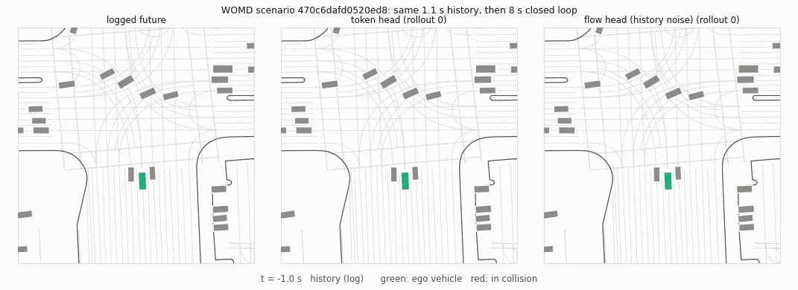
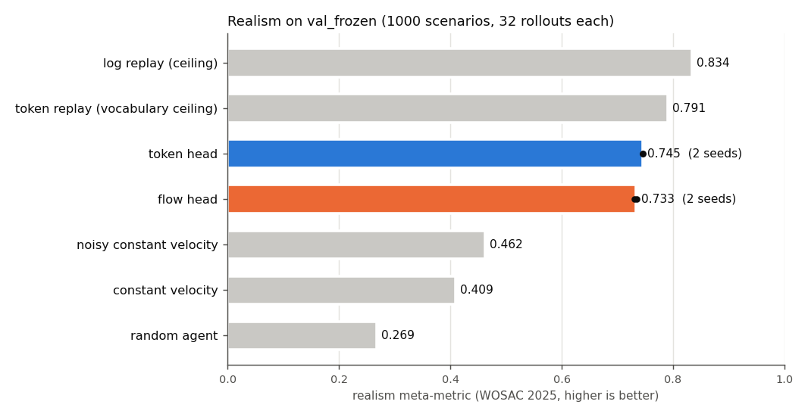
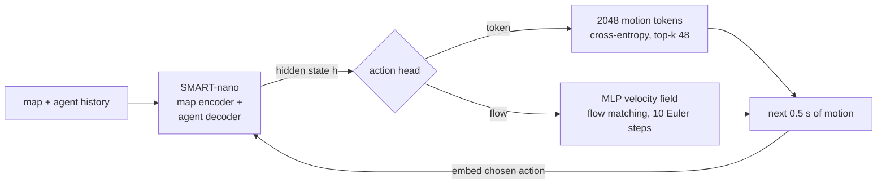
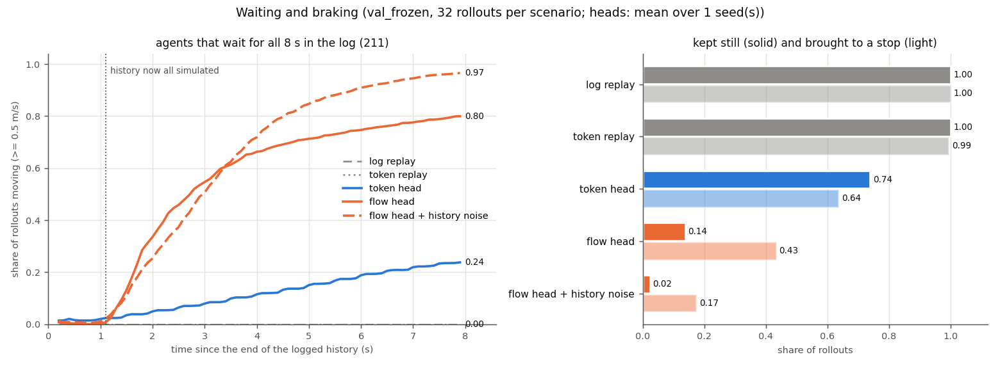
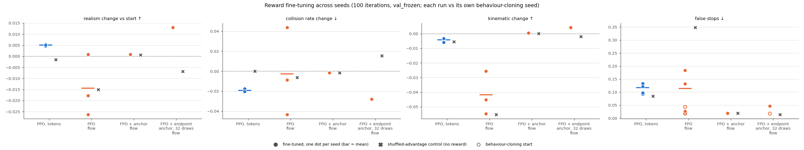
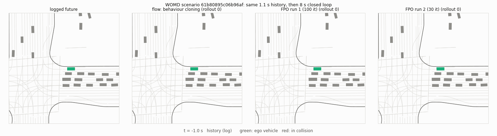

# Tokens vs Flows

> Discrete motion tokens or continuous flow matching: which action head makes a better traffic simulation agent, and which one gains more from reward fine-tuning?

[](docs/SETUP.md)
[](docs/SETUP.md)
[](https://waymo.com/open/)
[](eval/README.md)
[](#how-i-kept-it-honest)

I took one autoregressive traffic simulator (SMART-nano, 1M parameters), kept the backbone fixed and swapped only the action head. With the same data, the same seeds and the same optimiser steps, **the discrete token head is more realistic than a flow-matching head (WOSAC realism 0.745 vs 0.733)**, and the gap holds on a held-out test split. Reward fine-tuning widened it: **PPO on tokens gains a small, consistent +0.005** across three seeds, while FPO on the flow head either drifts or, once anchored, learns almost nothing.

<p align="center">
  <a href="figures/token_vs_flow_rollout.gif"></a>
  <br><sub>The same logged scene simulated by both heads for 8 s. Green: the ego vehicle. Red: an agent in collision.</sub>
</p>

**Where things are:** [Results](#results) · [How it works](#how-it-works) · [What I found](#what-i-found) · [Reward fine-tuning](#reward-fine-tuning) · [What didn't work](#what-didnt-work) · [How I kept it honest](#how-i-kept-it-honest) · [Reproduce](#reproduce) · [Repository](#repository)

| | |
|---|---|
| **Question** | On one fixed backbone, does a discrete token head or a continuous flow-matching head simulate traffic more realistically, and which gains more from RL? |
| **Backbone** | SMART-nano from [NVlabs/catk](https://github.com/NVlabs/catk): map encoder + agent decoder, hidden size 64, 1.0M parameters, 0.5 s actions |
| **Heads** | catk's 2048-token vocabulary (137k params) vs an MLP flow-matching velocity field (172k params) |
| **Data** | WOMD v1.3.0, 100 training shards (~10%); 1000 validation scenes for development, 1000 from disjoint shards held out |
| **Metric** | WOSAC 2025 realism meta-metric (kinematic, interactive, map), plus collision, off-road, minADE and diversity |
| **Scale** | 135 scored runs, 3 seeds per headline arm, ~108 GPU-hours on a single GPU |

* * *

## Results

Mean over 3 training seeds, 1000 validation scenarios × 32 closed-loop rollouts of 8 s each.

| model | realism ↑ | kinematic ↑ | interactive ↑ | map ↑ | collision ↓ | off-road ↓ | minADE (m) ↓ | diversity |
|---|---|---|---|---|---|---|---|---|
| log replay *(ceiling)* | 0.834 | 0.562 | 0.857 | 0.960 | 0.030 | 0.119 | 0 | 0 |
| token replay *(the vocabulary's ceiling)* | 0.791 | 0.516 | 0.812 | 0.920 | 0.044 | 0.132 | 0.16 | 0 |
| **token head** | **0.745** | 0.479 | 0.746 | 0.897 | 0.135 | 0.144 | 1.78 | 0.402 |
| flow head | 0.733 | 0.461 | 0.729 | 0.895 | 0.143 | 0.142 | 2.01 | 0.314 |
| flow head + history noise | 0.738 | 0.477 | 0.726 | 0.901 | 0.149 | 0.134 | 1.97 | 0.312 |
| **PPO-tuned token head** | **0.750** | | | | 0.116 | | 1.85 | |
| noisy constant velocity | 0.462 | 0.210 | 0.529 | 0.520 | 0.423 | 0.530 | 6.16 | 0.836 |
| constant velocity | 0.409 | 0.201 | 0.431 | 0.502 | 0.301 | 0.314 | 7.40 | 0 |

<p align="center"><a href="figures/realism_ladder.png"></a></p>

## How it works



- **One backbone, two heads.** A small patch to catk ([`patches/catk_action_hooks.patch`](patches/catk_action_hooks.patch)) exposes two hooks, *sample the next action* and *embed the chosen action*, so the map encoder, agent decoder and rollout loop run unchanged and only the head differs.
- **Token head:** catk's own. 2048 motion tokens per agent type (0.5 s box trajectories), trained with cross-entropy against the closest token, sampled with top-k 48.
- **Flow head:** an MLP velocity field conditioned on the decoder's hidden state. It predicts the next 0.5 s as 5 waypoints × (x, y, yaw), is trained with conditional flow matching and sampled with 10 Euler steps from Gaussian noise. The chosen action goes back in through the same box-contour embedding as a token.
- **History noise:** a flow variant trained on histories perturbed with noise matched to the tokeniser's own error, to test whether tokenisation acts as a regulariser against compounding error.
- **Reward fine-tuning:** leave-one-out realism over 4 rollouts of a scene (as in RLFTSim). PPO-clip with the exact log-ratio on tokens; FPO (flow policy optimisation) on the flow head, with optional anchors to the behaviour-cloned velocity field.

Design details, including every pitfall, are in [docs/DESIGN.md](docs/DESIGN.md).

## What I found

- **Tokens win on realism, and it's mostly late collisions.** The token head beats the flow head by 0.012 (paired over scenarios, p = 6e-26). About half the gap is collisions, and the timing is telling: flow agents collide *less* for the first ~5.5 s, then more ([field breakdown](figures/field_gaps_token_vs_flow.png), [event timing](figures/event_timing_s0.png)).
- **Flow agents can't wait.** Of the agents that stand still for the whole log, the token head keeps 72% still; the flow head keeps 19%. The token head reuses its standing-still token, while flow samples creep at a few cm/s and drift off once the history is entirely their own ([waiting and braking](figures/standstill.png)).
- **minADE favours tokens through diversity, not accuracy.** The flow head's *mean* displacement error is actually lower (4.11 vs 4.28 m at 8 s); the token head wins minADE because its samples spread more.
- **Motion texture differs by construction.** Token rollouts are smooth inside each 0.5 s token and jump at the joins, exactly like the tokenised log. Flow motion is closer to the real log inside an action.
- **Realism can be gamed by freezing traffic.** One fine-tuned run scored the best realism of any model while 24% of moving agents ended the rollout stopped: collisions halved, so the score rose. I always read realism next to false stops and jerk.

<p align="center">
  <a href="figures/standstill.png"></a>
</p>

## Reward fine-tuning

Every method is compared with its starting model **and** with a *shuffled-advantage control*: the same loop with advantages shuffled across rollouts, so the updates look the same but carry no reward signal. That separates what the reward does from what training on your own rollouts does. Three seeds each, 100 iterations.

| method | realism vs start | vs its control | verdict |
|---|---|---|---|
| **PPO-clip, token head** | **+0.0051** | **+0.0077** | real: fewer collisions, better interactions, a few more false stops |
| FPO, flow head | −0.0144 | +0.042 | unstable: seeds range from −0.026 to +0.001 |
| FPO + velocity anchor | +0.0013 | +0.0002 | stable, but the anchor holds the policy in place |
| FPO + clean-sample anchor, 32 draws | +0.0077 | +0.0096 | promising on seed 0, didn't repeat by the rule I set in advance |

<p align="center"><a href="figures/rl_seeds.png"></a></p>

- **FPO bends the flow, with or without reward.** Sampling paths become ~3× less straight in the FPO runs *and* in their reward-free controls, most of all near the noise end, where FPO's t²-weighted surrogate barely constrains the velocity field ([straightness along t](figures/flow_straightness_s0.png)).
- **Anchoring removes the drift, not the problem.** Each anchor shrinks the damage from reward-free updates and the reward's gain together. On this head, FPO's update seems to carry about as much noise as signal ([anchor study](figures/anchor_study_s0.png)).

<p align="center">
  <a href="figures/fpo_freezing_example.gif"></a>
  <br><sub>Metric gaming: an FPO run that raised realism by stopping traffic.</sub>
</p>

## What didn't work

| tried | what happened |
|---|---|
| Unanchored FPO on the flow head | Two runs with identical settings ended 0.033 apart; nondeterministic CUDA scatter-adds diverge from the first iteration and the closed loop amplifies them |
| A weaker velocity anchor | The bending came back and the early gain faded by 100 iterations |
| Anchoring only the predicted clean sample | Flow stayed straight, but the gain faded to +0.0004 |
| Offline AWR rounds on tokens | Self-imitation on rollouts worse than the log drifted away from the data; with logged scenes mixed in, four rounds ended at −0.003 |
| Scaling the flow's initial noise | Anything other than 1.0 only hurt (0.8: 0.731, 1.5: 0.490) |
| History noise as a fix for flow kinematics | It closes ~80% of the kinematic gap, but so do 20 Euler steps, so I can't separate solver error from exposure bias |

## How I kept it honest

- **Eval fixed before any model comparison.** Scoring code and splits were frozen after sanity checks: log replay beats every baseline, constant velocity beats random, and the fast metric matches the official Waymo implementation to within 1e-6 on 20 scenes.
- **A strict bar for "real".** A difference counts only if it exceeds twice the seed spread *and* a paired Wilcoxon test gives p < 0.05. Everything else is reported as no detectable difference, including the headline token vs history-noise flow comparison, which the tokens win on every seed but by less than the bar.
- **Controls for every RL method.** Shuffled-advantage runs with matched update statistics, three seeds each.
- **One look at the test split.** The held-out split was scored once, at the end, with final checkpoints. Every paired difference landed within 0.002 of its validation value, on the same side of the bar ([val vs test](figures/val_vs_test.png)).
- **Matched budgets.** Both heads see the same 100 shards, seeds (0, 1, 2) and 51k optimiser steps; fine-tuning arms match on iterations and rollouts.

<details>
<summary><b>Held-out test split</b></summary>

| model (test) | realism ↑ | kinematic | interactive | map | collision ↓ | off-road ↓ | minADE (m) ↓ |
|---|---|---|---|---|---|---|---|
| log replay *(ceiling)* | 0.831 | 0.554 | 0.856 | 0.958 | | | 0 |
| token head | 0.745 | 0.474 | 0.749 | 0.894 | 0.131 | 0.130 | 1.82 |
| flow head | 0.735 | 0.456 | 0.734 | 0.895 | 0.139 | 0.126 | 2.04 |
| flow head + history noise | 0.736 | 0.471 | 0.727 | 0.898 | 0.147 | 0.119 | 2.03 |
| PPO (token) | 0.749 | 0.470 | 0.759 | 0.896 | 0.113 | 0.123 | 1.88 |
| FPO (flow + noise) | 0.723 | 0.431 | 0.723 | 0.891 | 0.143 | 0.120 | 3.20 |
| FPO + velocity anchor | 0.737 | 0.471 | 0.729 | 0.899 | 0.144 | 0.118 | 2.02 |

</details>

<details>
<summary><b>Caveats</b></summary>

- Small scale: a 1M-parameter backbone, ~10% of WOMD, one GPU. Absolute scores are far below the leaderboard; the comparison is between heads on an identical backbone.
- The flow head is a minimal MLP velocity field, matched to the token head's size. Stronger continuous decoders exist (e.g. Flow-ERD's).
- Fine-tuning hyper-parameters were picked on short seed-0 pilots on the same validation split I report.
- 8 vs 32 FPO draws is matched on iterations, not compute (1.13 vs 2.07 GPU-hours).

</details>

## Reproduce

```bash
just clone                                    # catk + TrajTok at pinned commits, applies patches/
just setup                                    # uv env: Python 3.11.9, torch 2.4.1, PyG, TF 2.12
just import-data <path>/uncompressed/scenario # WOMD v1.3.0 shards from waymo.com/open
just data-subset && just preprocess           # fixed splits, catk caches, ground truth

export PYTHONPATH=src
python -m tokens_vs_flows.overfit --head flow                                  # one-batch sanity check
python -m tokens_vs_flows.train --head flow --seed 0 --steps 51000 --run-dir runs/bc_flow_s0
python -m tokens_vs_flows.rollout --run runs/bc_flow_s0                        # 32 closed-loop rollouts per scene
python eval/score.py --run runs/bc_flow_s0 --split val_frozen                  # realism + components
python eval/compare.py --a runs/bc_token_s{0,1,2} --b runs/bc_flow_s{0,1,2}    # paired, seed-aware comparison
python -m tokens_vs_flows.onpolicy --init runs/bc_token_s0 --iters 100 --run-dir runs/ppo_token_s0
```

Full environment and data notes: [docs/SETUP.md](docs/SETUP.md). Every scored run is a row in [results.tsv](results.tsv).

## Repository

| path | contents |
|---|---|
| [`src/tokens_vs_flows/`](src/tokens_vs_flows) | heads, model wrapper, training, rollouts, offline AWR, PPO/FPO, figures and animations |
| [`eval/`](eval) | WOSAC scoring, baselines, paired comparison, behaviour analyses, fixed splits |
| [`patches/`](patches) | the two-hook patch to catk's agent decoder |
| [`scripts/`](scripts) | environment setup, data import, splits and preprocessing |
| [`tests/`](tests) | unit tests for actions, heads, flow straightness and on-policy ratios |
| [`figures/`](figures) | every plot and animation referenced here |
| [`docs/`](docs) | design notes and setup |
| [`results.tsv`](results.tsv) | one row per scored run |

## Data and weights

WOMD is used under the [Waymo Open Dataset terms](https://waymo.com/open/terms) for research only. This repo contains no data and no trained weights, and neither will be published.

## Credits

Built on [catk / SMART](https://github.com/NVlabs/catk) (backbone, tokeniser, rollout loop) and [TrajTok](https://github.com/Thinklab-SJTU/TrajTok) (fast WOSAC metric). Methods from flow matching (Lipman et al.), FPO (flow policy optimisation), RLFTSim (leave-one-out realism reward) and Flow-ERD (diversity metric).
